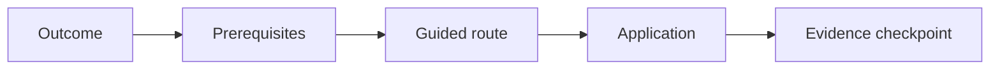

# Socratic Learn


**Learn any subject. Prove it by doing.**

Socratic Learn is an open-source tutoring protocol and launcher with portable
session memory. You run it from the terminal with a supported host that owns the
model runtime, provider credentials, and tools. Pi, Claude Code, Antigravity, or
a project-local Cursor skill can host sessions so you can learn any subject
through guided conversation that closes with real application, not self-reported
confidence alone.

[](https://www.python.org/downloads/)
[](LICENSE)
[](#honest-limitations)

## What you get

1. **A consistent method** across hosts: outcome, prerequisites, adaptive teaching,
   application, and an evidence checkpoint defined in the core protocol.
2. **Private learner records** under your home directory or a chosen project folder,
   without Socratic Learn storing provider credentials.
3. **Two session modes**: open-ended learning on any topic, or source-bounded study
   from an HTML page or textual PDF.

Mathematics and AI ship as starter curricula in this repository. They illustrate the
route builder; they are not product limits.

## Quick start

### Install Socratic Learn

The working public install is from GitHub with [pipx](https://pipx.pypa.io/).
The PyPI package is not public yet. The npm package is not public yet. Shorter
`pipx install socratic-learn` and `npx @socraticlearn/cli` commands will apply
only after the first release.

```text
pipx install "git+https://github.com/socraticlearn/socratic-learn.git"
socratic --version
```

### Connect a host (required)

Socratic Learn supplies the learning method and workspace. You must already have **one**
supported host installed, signed in, and able to reach a model:

- [Pi quickstart](https://github.com/earendil-works/pi/blob/main/packages/coding-agent/docs/quickstart.md)
- [Claude Code quickstart](https://code.claude.com/docs/en/quickstart)
- [Antigravity getting started](https://antigravity.google/docs/getting-started/)

Cursor is a **project integration** (see [Cursor adapter](adapters/cursor/README.md)),
not a menu launcher host.

### Set a default host

```text
socratic host list
socratic host set pi
socratic host clear
```

`socratic host set NAME` saves a persistent default for later launches.
`socratic --agent NAME` is a one-session override and does not change that default.
`socratic host clear` removes the saved default so the launcher prompts again.

### Start learning

```text
socratic
socratic "I want to learn linear algebra"
socratic --agent pi
socratic --here
```

`socratic` with no goal opens a small menu (new session, recent threads). Passing a
goal skips the menu. `--here` uses the current directory as the learning project;
otherwise personal data lives under
`~/.socratic-learn/learning/.socratic-learn/workspace/`.

### Study a source

```text
socratic read https://example.org/article
socratic read paper.pdf
socratic read paper.pdf evaluate the main claim and its evidence
```

Limits, bundle layout, and safety notes are in [Source study](docs/source-study.md).

## How a session moves



Behavior is specified in [pedagogy](core/pedagogy.md), [session protocol](core/session-protocol.md),
[assessment](core/assessment.md), and [evidence policy](core/evidence-policy.md).

## Supported launcher hosts

| Host | Role |
| --- | --- |
| Pi | Interactive terminal harness (`/model`, `/login`) |
| Claude Code | Official Claude Code terminal |
| Antigravity | Launched via `agy` |
| Cursor | Project-local skill via `socratic install cursor` |

Hosts keep authentication, quotas, tools, and model choice. Socratic Learn prepares
the protocol and launch payload; it does not read or store provider credentials.

## Privacy and ownership

- Session checkpoints and thread metadata persist in your workspace; transient launch
  control JSON is not written to disk by the launcher.
- Resuming uses structured summaries and launcher checkpoints, not provider chat logs
  as session memory.
- Package install is separate from project adapters: after install, use
  `socratic install TARGET PROJECT` (or `python -m socratic_learn install` from a
  source checkout). See [Installation and lifecycle](docs/universal-installation.md).

## Evaluation status

Synthetic scenario suites score hosted sessions against the tracked rubric in
[evaluation/fixtures/rubric.json](evaluation/fixtures/rubric.json). Example
reports include
[article-reading-v1](evaluation/reports/article-reading-v1.md) and the
[2026-11-06 antigravity baseline](evaluation/reports/2026-11-06-antigravity-baseline.md).

These runs check protocol behavior in scripted scenarios. They do not prove
human learning outcomes, retention, or superiority over using the host alone.

## Honest limitations

- Progress depends on the model, host tools, and your attempts; supporting any subject
  does not guarantee accuracy on every topic.
- Source study has fixed size and format limits; there is no OCR or JavaScript
  rendering (details in [Source study](docs/source-study.md)).
- Research cited in the docs informed design choices; it does not certify this product
  as a mastery guarantee. See [learner preference patterns](docs/research/learner-preference-patterns.md).

## Documentation

- [Source study](docs/source-study.md)
- [Installation and lifecycle](docs/universal-installation.md)
- [Launcher host contract](docs/launcher-adapters.md)
- [Pi adapter and model help](adapters/pi/README.md)
- [Claude Code adapter](adapters/claude-code/README.md)
- [Cursor adapter](adapters/cursor/README.md)
- [Adding an adapter](docs/adding-an-adapter.md)
- [Manifest reference](docs/manifest-reference.md)

Source and issues: [github.com/socraticlearn/socratic-learn](https://github.com/socraticlearn/socratic-learn)

## License

Socratic Learn is available under the [MIT License](LICENSE).
